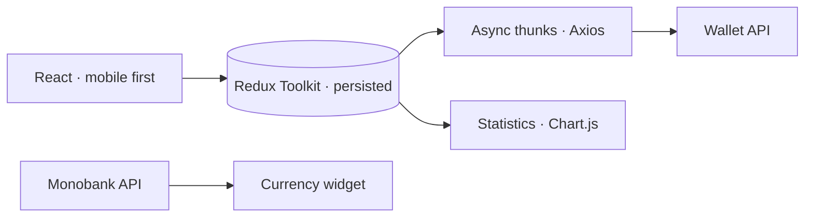

<div align="center">



<p>
  <a href="https://money-guard-app-eight.vercel.app"></a>
  
  
  
</p>

<p><em>A fully responsive personal finance app built with React and Redux by a team.<br>
Register, record income and expenses, watch your balance update and read your statistics.</em></p>

<table>
  <tr>
    <td width="60%"></td>
    <td width="20%"></td>
    <td width="20%"></td>
  </tr>
</table>

</div>


## Features

| | |
|---|---|
| **Authentication** | Register, log in and log out; the JWT is persisted with redux-persist. |
| **Transactions** | Create, read, update and delete income and expenses, in a table on desktop and cards on mobile. |
| **Quick add** | A floating "+" button and modal add / edit forms with react-hook-form, Yup and a date picker. |
| **Balance** | The total balance stays in sync automatically. |
| **Statistics** | Monthly breakdowns with Chart.js. |
| **Currency** | Exchange rates from the Monobank API. |
| **Feedback** | Toast-based error handling and loaders. |




## Türkçe özet

**Money Guard**, React ve Redux ile ekip olarak geliştirdiğimiz, tamamen duyarlı bir kişisel finans uygulaması. Kullanıcılar kayıt olup gelir ve gider işlemleri ekleyebiliyor, düzenleyip silebiliyor; bakiye anlık güncelleniyor, aylık istatistikler grafikle gösteriliyor ve döviz kurları takip ediliyor. Bu projede işlem ekleme/düzenleme akışından ve modallardan sorumluydum.


<h2 id="team-members">👥 Team Members & Responsibilities</h2>

<h3>👤 Egemen — Architecture, Auth Core & Global State</h3>
<ul>
  <li>Redux store configuration</li>
  <li>JWT persistence (redux-persist)</li>
  <li>Login & Register operations</li>
  <li>Private/Public routing</li>
  <li>Global loader implementation</li>
</ul>

<h3>👤 Gülnihan — Auth Pages & UI Layout</h3>
<ul>
  <li>Registration & Login pages</li>
  <li>Form validation logic</li>
  <li>Password strength indicator</li>
  <li>Header & Logout flow</li>
</ul>

<h3>👤 Hatice — Dashboard & Transactions List</h3>
<ul>
  <li>Dashboard layout</li>
  <li>Navigation</li>
  <li>TransactionsList rendering</li>
  <li>Desktop & Mobile transaction layout</li>
  <li>Balance component</li>
</ul>

<h3>👤 Kutluhan — Transaction CRUD & Modals</h3>
<ul>
  <li>Floating Add Transaction button</li>
  <li>ModalAddTransaction</li>
  <li>AddTransactionForm (react-hook-form + Yup)</li>
  <li>ModalEditTransaction</li>
  <li>EditTransactionForm</li>
  <li>Delete transaction logic</li>
  <li>Auto balance synchronization</li>
</ul>

<h3>👤 Nur Seda — Statistics & Currency</h3>
<ul>
  <li>Monthly statistics queries</li>
  <li>Chart.js integration</li>
  <li>Statistics filtering (month/year)</li>
  <li>Monobank API integration</li>
  <li>LocalStorage currency cache logic</li>
</ul>

<hr />

<h2>🔗 Team Links</h2>

<ul>
  <li>Egemen Yılmaz — 
    <a href="https://www.linkedin.com/in/egemen-y%C4%B1lmaz/" target="_blank">LinkedIn</a> | 
    <a href="https://github.com/Egemen-Yilmaz" target="_blank">GitHub</a>
  </li>

  <li>Hatice van Daalen — 
    <a href="https://www.linkedin.com/in/haticevand/" target="_blank">LinkedIn</a> | 
    <a href="https://github.com/HaticevanD" target="_blank">GitHub</a>
  </li>

  <li>Kutluhan Gül — 
    <a href="https://www.linkedin.com/in/kutluhangil/" target="_blank">LinkedIn</a> | 
    <a href="https://github.com/kutluhangil" target="_blank">GitHub</a>
  </li>

  <li>Nur Seda Ağgünlü — 
    <a href="https://www.linkedin.com/in/nur-seda-aggunlu/" target="_blank">LinkedIn</a> | 
    <a href="https://github.com/nursedaaggunlu" target="_blank">GitHub</a>
  </li>

  <li>Gülnihan Yazıcı — 
    <a href="https://www.linkedin.com/in/gulnihan-yazici/" target="_blank">LinkedIn</a> | 
    <a href="https://github.com/gnihanyazici" target="_blank">GitHub</a>
  </li>
</ul>


## Development

```sh
npm install
cp .env.template .env
npm run dev      # http://localhost:5174
npm run build
```

<div align="center">
<br>
<a href="https://github.com/kutluhangil"></a>
<sub>Fork of <a href="https://github.com/Egemen-Yilmaz/MoneyGuard">Egemen-Yilmaz/MoneyGuard</a> · a GoIT Full Stack team project.</sub>
</div>
